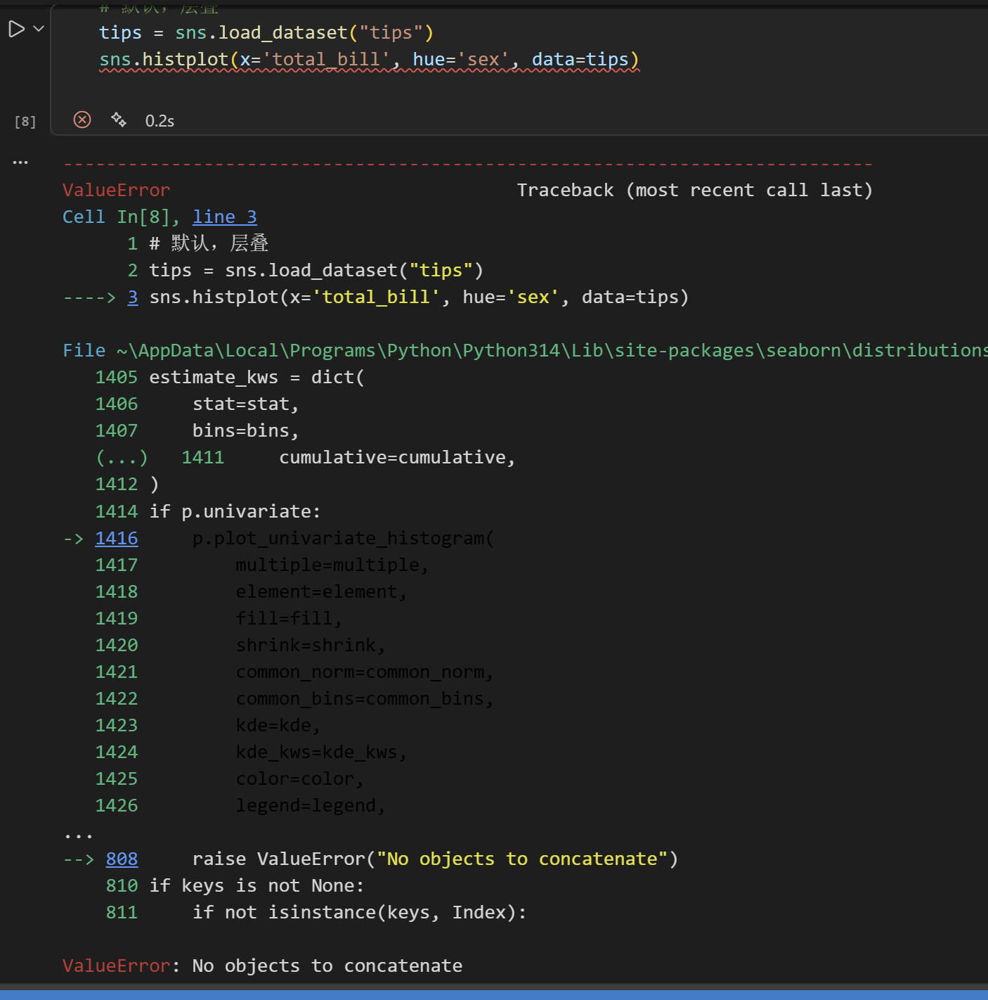
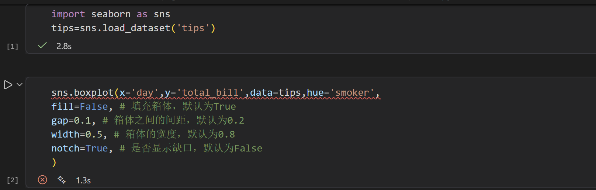
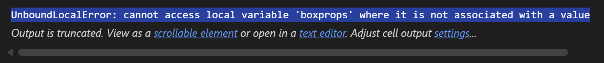
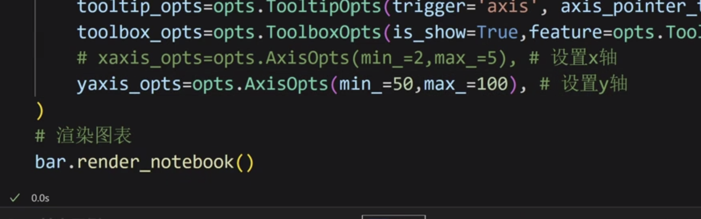
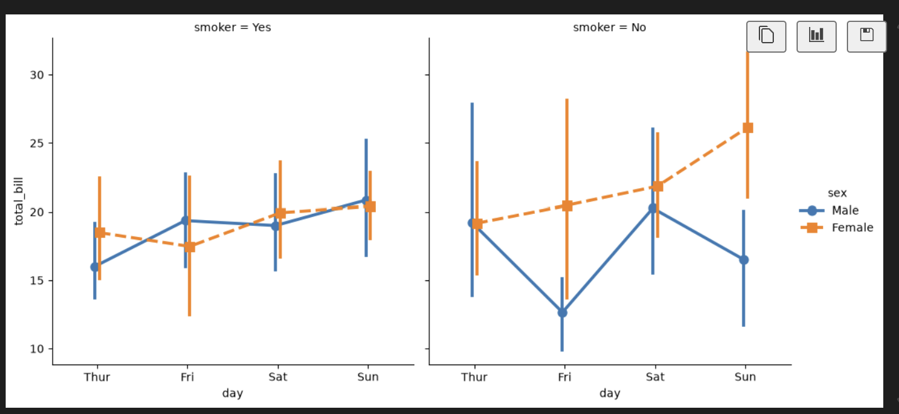
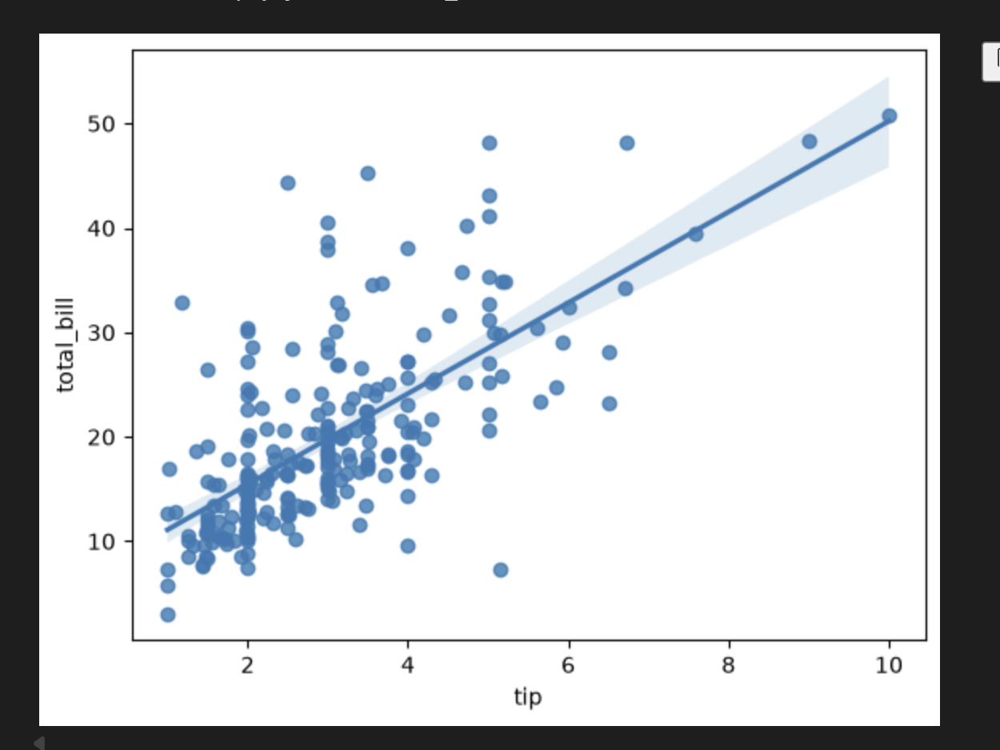
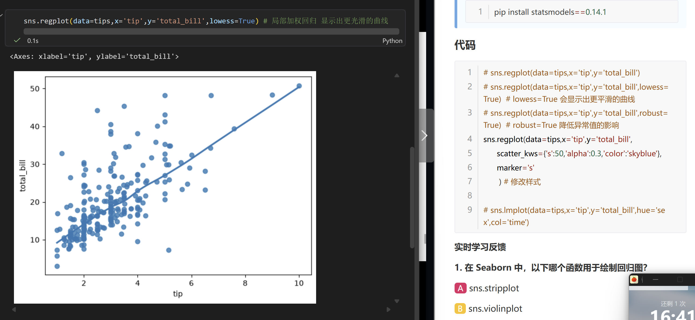

# 问题

### 1. 为什么导入数据库之后，还是显示ValueError: No objects to concatenate，单独打印过导入的数据库，确认过已经正确导入

### 2. 散点图什么时候用strip，什么时候用swarm呀

### 3. 这是为什么报错呀

### 4. 什么时候画小提琴图呀，感觉小提琴图和箱线图有点像呀

### 5. 数据量大的时候，怎么判断哪些是重要的维度呀

### 6.pivot（）可以针对excel表读取出的数据使用吗，里面参数设置可以用index=df['..']这样的形式吗

### 7. 点图知识里的”除了点的位置表示中心趋势外，点图还通过垂直线（误差棒）表示中心趋势的不确定性，通常是置信区间。这有助于了解估计值的精度“这句话没看懂

### 8. matplotlib里有类似pychart这样的数据筛选的功能吗

### 9. 垂直的那条线就是误差棒吗，中间的点是代表中心值吗

### 10. 这个阴影区就是误差条吗，这怎么分析呀

### 11. 什么时候需要显示出更光滑的曲线呀，作用是什么呀

### 12. 如何人为设置KDE带宽

- “想看清大趋势、数据点多且乱时，用平滑（如增加 KDE 带宽）；想保留局部细节用低平滑。如果只要画一条绝对的回归线，不想让阴影干扰视线，就可以去掉置信区间。”
